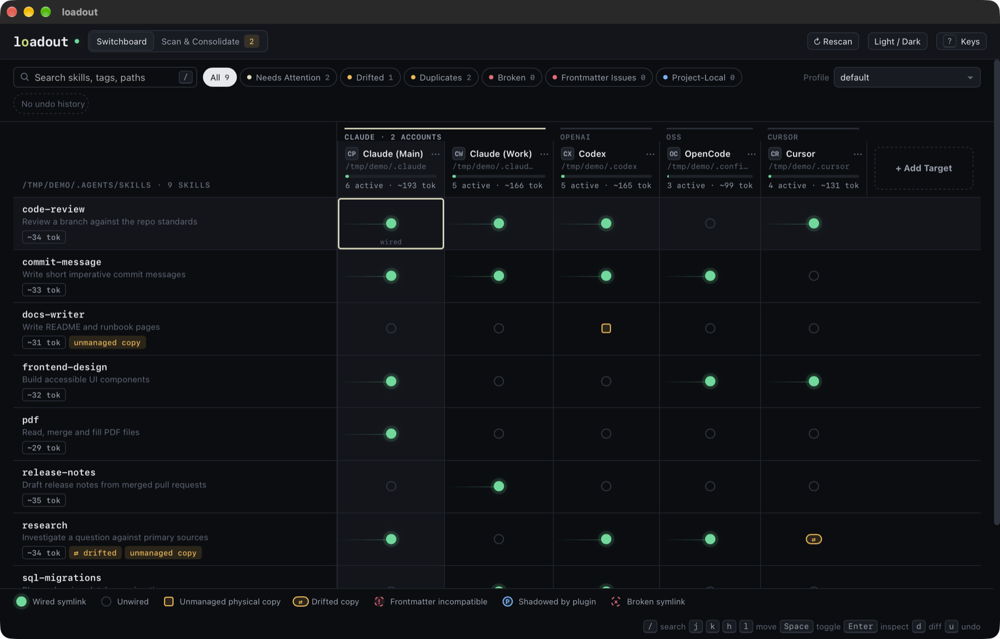

# singlet

[](https://github.com/witseko/singlet/actions/workflows/ci.yml)
[](LICENSE)

Manage coding agent skills from one place. Store each skill once, toggle it per agent or account via symlinks, and eliminate duplicate folders and drift.



## Why

Each agent (Claude Code, Codex, Cursor, OpenCode, and others) reads skills from its own folder. With several agents or accounts, the same skill ends up copied in many places, and the copies drift apart.

`singlet` keeps one real copy of each skill in `~/.agents/skills` and puts symlinks where the agents look. Edit a skill once, and every agent sees the change. Turn each skill on or off per agent from a desktop UI, a terminal UI, the CLI, or an MCP server.

One native binary, no dependencies, macOS and Linux.

> **Status: 0.1.0.** Back up `~/.agents` and your agent folders before the first `dedup --apply`.

## Install

Download the archive for your system from the [releases page](https://github.com/witseko/singlet/releases) (macOS 13+, or Linux with glibc 2.39+ such as Ubuntu 24.04), together with `SHA256SUMS`. In the commands below, change the architecture in the file name (`arm64` or `x86_64`) to match your machine.

On macOS, check the archive and put the binary on your `PATH`:

```bash
shasum -a 256 -c --ignore-missing SHA256SUMS
```

```bash
tar -xzf singlet-v0.1.0-macos-arm64.tar.gz && cp singlet-v0.1.0-macos-arm64/singlet /usr/local/bin/
```

The macOS binaries are not signed. If macOS blocks the binary, run `xattr -d com.apple.quarantine /usr/local/bin/singlet`.

On Linux, check the archive and put the binary in `~/.local/bin` (make sure that folder is on your `PATH`):

```bash
sha256sum -c --ignore-missing SHA256SUMS
```

```bash
tar -xzf singlet-v0.1.0-linux-x86_64.tar.gz && install -D -m 755 singlet-v0.1.0-linux-x86_64/singlet ~/.local/bin/singlet
```

For the native UI window on Linux, install GTK 3 and WebKitGTK 4.1. Without them, `singlet ui` opens in your web browser. See [Desktop launcher](docs/usage.md#desktop-launcher) for package names.

Or build from source (needs a C++20 compiler and `make`; on Ubuntu, `sudo apt install clang make`):

```bash
git clone https://github.com/witseko/singlet.git && cd singlet && make release
```

Then copy `bin/singlet` to a folder on your `PATH`.

To install a desktop launcher (Launchpad/Spotlight on macOS, app menu on Linux) from the checkout:

```bash
make install-app
```

See [Desktop launcher](docs/usage.md#desktop-launcher) for custom paths and `make uninstall-app`.

## Quick start

1. See what is on your machine (read-only):

   ```bash
   singlet scan
   ```

2. Open the UI. Rows are skills, columns are agents. Click a cell to turn a skill on or off:

   ```bash
   singlet ui
   ```

3. Preview how duplicates will merge (read-only), then apply:

   ```bash
   singlet dedup
   ```

   ```bash
   singlet dedup --apply
   ```

4. Undo the last merge if you do not like it:

   ```bash
   singlet undo
   ```

To try it without touching your real setup, add `--home /tmp/singlet-sandbox` to any command.

## Learn more

- [Usage](docs/usage.md): all commands, supported agents, terminal UI keys, MCP setup, and what `singlet` writes.
- [Architecture](docs/architecture.md): how the parts fit together.
- [Contributing](CONTRIBUTING.md): build, test, and code layout.
- [Changelog](CHANGELOG.md) and [Code of Conduct](CODE_OF_CONDUCT.md).

## Security

The UI server listens on `127.0.0.1` only and has no authentication, so do not expose its port. `singlet` makes no network calls. To report a vulnerability, see [SECURITY.md](SECURITY.md).

## License

[MIT](LICENSE)
